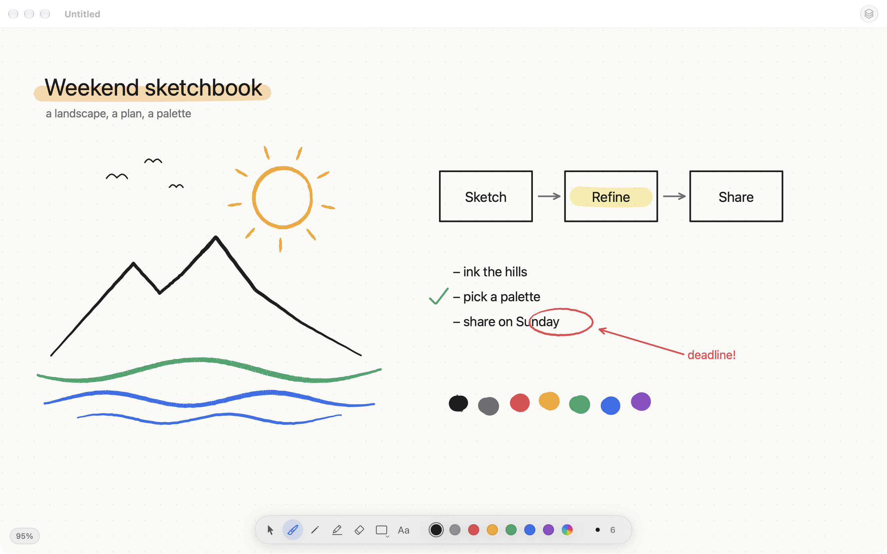
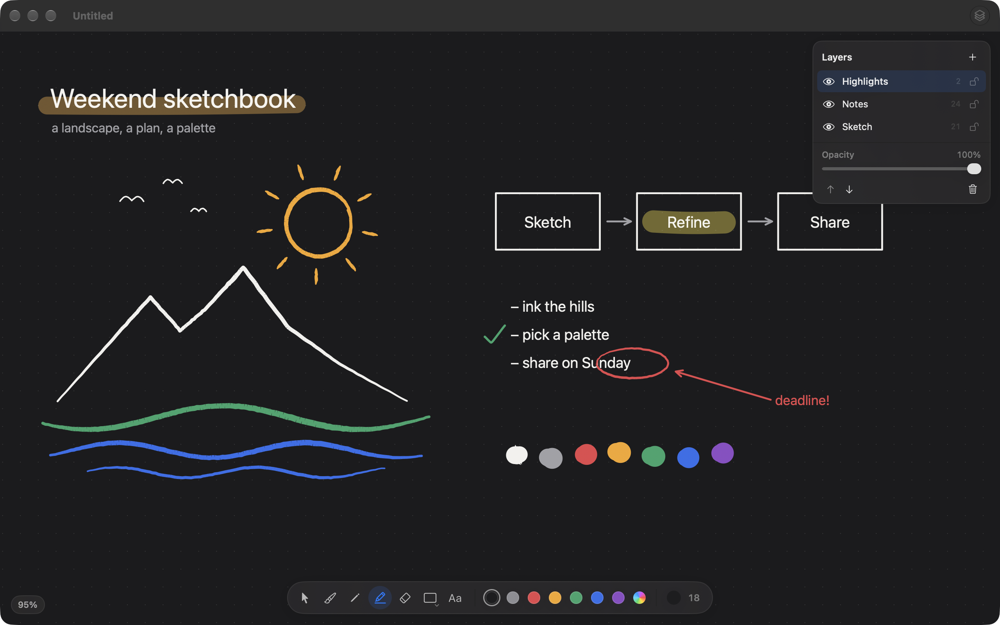

<p align="center">
  
</p>

<h1 align="center">Inkflow</h1>

<p align="center">
  A small, fast sketchbook for the Mac.<br>
  An infinite canvas, pressure-sensitive ink, shapes, text and layers, and nothing in your way.
</p>

<p align="center">
  <a href="https://github.com/pronzzz/inkflow/releases/latest"></a>
  
  <a href="https://github.com/pronzzz/inkflow/actions/workflows/ci.yml"></a>
  <a href="LICENSE"></a>
</p>



Inkflow sits between Preview's markup tools and a full painting app. Open it, draw, close it. It is for sketches, diagrams, whiteboard-style thinking and annotated notes, and it saves everything as ordinary documents.

## Features

- **Infinite canvas.** Two-finger scroll to pan, pinch or ⌘-scroll to zoom from 10% to 1600%, hold Space to drag.
- **Ink that feels like ink.** The brush follows pen pressure on tablets (Wacom, Sidecar with Apple Pencil). With a mouse or trackpad, speed thins the line and the ends taper.
- **Tools:** brush, pencil, highlighter, eraser, line, arrow, rectangle, ellipse and text.
- **Layers** you can reorder, rename, hide, lock and fade. The eraser only affects its own layer.
- **Select, move, copy and paste** anything you have drawn. Undo covers everything.
- **Export** to PNG or vector PDF, or copy a drawing straight into another app.
- **Quick Look** previews and Finder thumbnails for `.inkflow` files.
- **Keyboard first.** Every tool has a single-key shortcut. Press <kbd>?</kbd> in the app for the full list.
- Follows the system light and dark appearance, with White, Paper, Grey and Dark canvas colours.



## Install

1. Download **Inkflow-2.0.0.dmg** from the [latest release](https://github.com/pronzzz/inkflow/releases/latest).
2. Open it and drag **Inkflow** into **Applications**.
3. The first time you open Inkflow, macOS will say it can't check it for malware, because the app is not notarized. Open **System Settings → Privacy & Security**, scroll down and click **Open Anyway**.

Requires macOS 14 Sonoma or later. Runs natively on Apple silicon and Intel.

## Using Inkflow

| Tool | Key | | Canvas | Shortcut |
|---|---|---|---|---|
| Select | <kbd>V</kbd> | | Pan | Scroll, or hold <kbd>Space</kbd> and drag |
| Brush | <kbd>B</kbd> | | Zoom | Pinch, or <kbd>⌘</kbd>-scroll |
| Pencil | <kbd>P</kbd> | | Zoom in / out | <kbd>⌘=</kbd> / <kbd>⌘−</kbd> |
| Highlighter | <kbd>M</kbd> | | Actual size / fit | <kbd>⌘0</kbd> / <kbd>⌘9</kbd> |
| Eraser | <kbd>E</kbd> | | Grid | <kbd>⌘'</kbd> |
| Line / Arrow | <kbd>L</kbd> / <kbd>A</kbd> | | Layers panel | <kbd>⌥⌘L</kbd> |
| Rectangle / Ellipse | <kbd>R</kbd> / <kbd>O</kbd> | | New layer | <kbd>⇧⌘N</kbd> |
| Text | <kbd>T</kbd> | | Export PNG / PDF | <kbd>⇧⌘E</kbd> / <kbd>⌥⇧⌘E</kbd> |
| Hand | <kbd>H</kbd> | | Copy as image | <kbd>⇧⌘C</kbd> |

- <kbd>[</kbd> and <kbd>]</kbd> change the size; <kbd>1</kbd>–<kbd>9</kbd> set opacity from 10% to 90%, <kbd>0</kbd> sets 100%.
- Hold <kbd>⇧</kbd> while drawing a shape for squares, circles and 45° lines.
- With the select tool, drag a box to select several items, <kbd>⇧</kbd>-click to add, arrow keys to nudge, <kbd>⌫</kbd> to delete, <kbd>⌘D</kbd> to duplicate.
- Text: click to start typing, <kbd>↩</kbd> to finish, <kbd>⇧↩</kbd> for a new line. Double-click text to edit it.

## Building from source

You need Xcode 16 or later and [XcodeGen](https://github.com/yonaskolb/XcodeGen).

```bash
brew install xcodegen
git clone https://github.com/pronzzz/inkflow.git
cd inkflow
xcodegen generate
open Inkflow.xcodeproj
```

`project.yml` is the source of truth for the Xcode project. Run `xcodegen generate` after adding or removing files and commit the regenerated `Inkflow.xcodeproj` (CI checks that it is up to date).

Run the tests from Xcode, or:

```bash
xcodebuild -project Inkflow.xcodeproj -scheme Inkflow -derivedDataPath build/dd test
```

### Project layout

```
Inkflow/
  App/        app entry, menus, the per-window Editor (tools, selection, undo), launch options
  Model/      Drawing, layers and items; the .inkflow package format; 1.0 file import
  Engine/     Geometry (stroke outlines, hit testing) and the Core Graphics renderer
  Canvas/     CanvasView, the AppKit view that handles input, pan, zoom and drawing
  UI/         SwiftUI tool palette, layers panel and shortcuts sheet
InkflowTests/ file format, geometry and editor tests
scripts/      release, screenshots and icon generation
```

How it fits together:

- A document holds one `Drawing` value (background colour plus layers of items). Every edit goes through `Editor.perform`, which swaps in the new value and registers the old one with the window's undo manager. That single path gives undo, redo and the document's edited state.
- `CanvasView` draws idle content as vectors with cached paths. While a mark is being drawn it caches the layers below, the active layer and the layers above as bitmaps, then redraws only a small rectangle around each new point.
- An `.inkflow` file is a package: `drawing.json`, plus `QuickLook/Thumbnail.png` and `QuickLook/Preview.pdf` for Finder.

### Scripts

| Script | What it does |
|---|---|
| `scripts/release.sh` | Runs the tests and builds a universal Release app, `dist/Inkflow-<version>.dmg`, a zip and `SHA256SUMS.txt`. Add `--publish` to create the GitHub release with notes from `CHANGELOG.md`. Needs `brew install create-dmg`. |
| `scripts/screenshots.sh` | Renders the README screenshots from the app's built-in demo drawing (`--demo`). Needs Screen Recording permission for your terminal. |
| `swift scripts/make_art.swift` | Draws the app icon (`icon`, `appiconset`) and the DMG background (`dmg`). |

### Releasing

1. Bump `MARKETING_VERSION` (and `CURRENT_PROJECT_VERSION`) in `project.yml`, then run `xcodegen generate`.
2. Add a `## [x.y.z]` section to `CHANGELOG.md`.
3. Either run `scripts/release.sh --publish` on a Mac, or push a `vx.y.z` tag and let the Release workflow build and publish it.

## Contributing

Issues and pull requests are welcome. Please keep changes small and focused, run the tests before opening a pull request, and keep the interface quiet: Inkflow should stay a tool you can learn in a minute.

## License

[MIT](LICENSE) © 2026 Pranav Dwivedi
